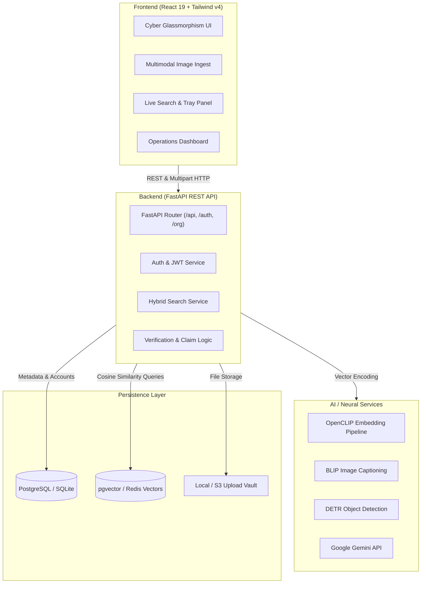

# 4O4 FOUND — Intelligent Multimodal Lost & Found Platform

<div align="center">


**An AI-driven lost and found ecosystem powered by OpenCLIP, Sentence Transformers, pgvector, and Google Gemini.**

[Features](#-key-features) • [Tech Stack](#-technology-stack) • [Architecture](#-system-architecture) • [Getting Started](#-installation--setup) • [API Overview](#-api-endpoints) • [AI/ML Engine](#-aiml-functionality) • [Deployment](#-deployment)

---

</div>

## 📌 Introduction

Traditional lost and found boards rely on manual searching, exact keyword queries, and unverified handoffs. **4O4 FOUND** transforms this experience into a modern, cyber-styled AI recovery engine. By leveraging multimodal vector embeddings across both images and descriptions, 4O4 FOUND matches lost items with found vault entries regardless of vocabulary differences, and secures recoveries via zero-knowledge challenge-response verification.

---

## 🚀 Key Features

- **Multimodal Visual & Text Matching**: Joint vector embeddings via OpenCLIP (`ViT-B/32`) and Sentence Transformers rank items by visual similarity and semantic context.
- **Instant Confidence Scoring**: Visual percentage meters and multi-dimensional score breakdowns (Vision, Text, and Location proximity).
- **Interactive Dual Reporting**:
  - **Report Lost Item**: Ingest images and descriptions with auto-tagging.
  - **Register Found Item**: Custodian intake with geographic map coordinates and security challenge setup.
- **Zero-Knowledge Ownership Verification**: Finders set secret challenge questions (e.g., *"What sticker is on the laptop lid?"*). Authentic claimants answer correctly to mark items as recovered and reveal collection logistics.
- **Organization Operations Dashboard**: Real-time recovery metrics, lost inquiries, custody vault inventory, and item audit logs.
- **Saved Candidates Tray**: Pin and compare potential candidate items side-by-side with cross-page memory.
- **Responsive Cyber-Navy Glassmorphic UI**: Deep navy background (`#030712`), cyan and violet glowing accents, and lightweight micro-interactions.

---

## 🛠 Technology Stack

| Layer | Technologies |
| :--- | :--- |
| **Frontend** | React 19, Tailwind CSS v4, Lucide React, Framer Motion, Canvas Confetti, Vite |
| **Backend** | Python 3.13, FastAPI, SQLAlchemy ORM, Uvicorn, Pydantic v2 |
| **AI / Machine Learning** | OpenCLIP (`clip-ViT-B-32-multilingual-v1`), BLIP Image Captioning, DETR ResNet-50 Object Detection, Google Gemini API |
| **Database & Vector Storage** | PostgreSQL + pgvector, SQLite fallback (`404_found.db`), Redis vector caching |
| **Authentication & Security** | JWT (JSON Web Tokens), bcrypt / SHA-256 password hashing, zero-leakage challenge verification |
| **Deployment Targets** | Vercel (Frontend), Render / Railway (FastAPI Backend) |

---

## 🏛 System Architecture



---

## 📂 Folder Structure

```
4O4_FOUND/
├── backend/
│   ├── database/          # PostgreSQL, SQLite, and Redis connection setup
│   ├── middleware/        # JWT auth, CORS, and request interceptors
│   ├── models/            # SQLAlchemy database models (Item, ClaimMessage, Org)
│   ├── routes/            # REST API route controllers (items, search, claim, auth)
│   ├── schemas/           # Pydantic validation schemas
│   ├── services/          # Business logic: AI service, hybrid search, auth
│   ├── templates/         # Search templates & HTMX snippets
│   ├── themes/            # Organization branding presets
│   ├── uploads/           # Image file storage
│   ├── config.py          # Centralized configuration & environment loader
│   ├── main.py            # FastAPI entry point
│   └── requirements.txt   # Python backend dependencies
├── frontend/
│   ├── public/            # Public static assets
│   ├── src/
│   │   ├── assets/        # Visual branding and illustrations
│   │   ├── components/
│   │   │   ├── auth/      # LoginForm, ConsentCheckbox, GoogleLogin
│   │   │   ├── item/      # ItemDetail, ClaimForm, MapPicker
│   │   │   ├── layout/    # Header, FlowGrid
│   │   │   ├── results/   # MatchCard, ResultsPanel, TrayPanel, FilterPanel
│   │   │   └── search/    # ImageUploader, DescriptionInput, SearchContainer
│   │   ├── context/       # AuthContext, BrandingContext
│   │   ├── hooks/         # useSearch, useTray, useTranslation
│   │   ├── pages/         # HomePage, ExplorePage, ReportPage, DashboardPage, TeamPage, LoginPage
│   │   ├── services/      # Axios API clients & session persistence
│   │   ├── index.css      # Tailwind v4 styles, glassmorphism, & glow effects
│   │   ├── App.jsx        # Routing configuration
│   │   └── main.jsx       # React application entry
│   ├── package.json       # Frontend dependencies & scripts
│   └── vite.config.js     # Vite configuration with API proxy
├── .env.example           # Environment configuration template
├── .gitignore             # Git ignore rules for node_modules, venv, and secrets
├── README.md              # Project documentation
└── RUN_PROJECT.md         # Quick-start instructions
```

---

## ⚡ Installation & Setup

### Prerequisites
- **Node.js** (v18 or higher) & **npm**
- **Python** (v3.10 or higher)
- **Git**

### 1. Clone the Repository
```bash
git clone https://github.com/SHREYA-03112006/4O4_Found.git
cd 4O4_Found
```

### 2. Configure Environment Variables
Copy the template and adjust configurations:
```bash
cp .env.example backend/.env
```

### 3. Backend Setup
```bash
cd backend
python -m venv venv

# Windows (PowerShell)
.\venv\Scripts\Activate.ps1

# Linux / macOS
source venv/bin/activate

pip install -r requirements.txt
```

### 4. Frontend Setup
```bash
cd ../frontend
npm install
```

---

## 🖥 Running the Application

### Start the Backend Server
```bash
cd backend
.\venv\Scripts\Activate.ps1
uvicorn main:app --reload --port 8000
```
- API Health Status: `http://127.0.0.1:8000/api/health`
- Swagger Interactive Documentation: `http://127.0.0.1:8000/docs`

### Start the Frontend Client
```bash
cd frontend
npm run dev
```
Open **[http://localhost:5173](http://localhost:5173)** in your browser.

---

## 🔐 Environment Variables (.env.example)

| Variable | Description | Default |
| :--- | :--- | :--- |
| `DEV_MODE` | Enables local development settings | `true` |
| `JWT_SECRET` | Secret key used for signing JWT tokens | `your_secret_key` |
| `DATABASE_URL` | PostgreSQL connection string (defaults to SQLite if unset) | `sqlite:///./404_found.db` |
| `HF_API_TOKEN` | Hugging Face token for CLIP, BLIP, and DETR inference | Optional in offline mode |
| `GEMINI_API_KEY` | Google Gemini API key for smart queries and verification | Optional |
| `UPLOAD_DIR` | Directory for uploaded item images | `uploads` |

---

## 📡 API Overview

| Method | Endpoint | Description |
| :--- | :--- | :--- |
| `GET` | `/api/health` | Health check endpoint |
| `GET` | `/api/items` | List registered lost and found items |
| `POST` | `/api/items` | Submit a new lost or found item report |
| `GET` | `/api/items/{id}` | Retrieve details of an item |
| `POST` | `/api/upload` | Ingest item images, generate tags and embeddings |
| `POST` | `/api/search` | Multimodal hybrid search (text, image, and filters) |
| `POST` | `/api/claims` | Submit an ownership verification challenge answer |
| `POST` | `/auth/login` | Authenticate organization administrator |
| `POST` | `/auth/register`| Create organization workspace and admin user |

---

## 🧠 AI/ML Functionality

1. **Multimodal Feature Extraction**:
   When an image is uploaded, it is passed through OpenCLIP (`clip-ViT-B-32-multilingual-v1`). Dense vector representations capture shape, color palettes, and category representations.
2. **Dense Text Embeddings**:
   Natural language descriptions are embedded into the same shared multidimensional vector space, allowing a text description like *"navy canvas rucksack with leather buckles"* to match directly with an unlabelled image of a navy backpack.
3. **Hybrid Search & Re-Ranking**:
   Cosine similarity scores are computed against registered items, combined with structured relational filters (color, brand, category, and location metadata).
4. **Resilient Offline Fallbacks**:
   When offline or running without external API tokens, the application gracefully activates local text matching and heuristic similarity scoring.

---

## 🚀 Deployment

### Frontend (Vercel)
1. Push your repository to GitHub.
2. Import the project into **Vercel**.
3. Set the Root Directory to `frontend`.
4. Add the environment variable `VITE_API_URL` pointing to your deployed backend.

### Backend (Render / Railway)
1. Deploy a new Web Service pointing to the `backend` folder.
2. Build Command: `pip install -r requirements.txt`
3. Start Command: `uvicorn main:app --host 0.0.0.0 --port $PORT`
4. Configure environment variables (`JWT_SECRET`, `HF_API_TOKEN`, `DATABASE_URL`).

---

## 🔮 Future Improvements

- [ ] Mobile app build with React Native / Expo.
- [ ] Push notifications & SMS alerts when high-confidence matches are cataloged.
- [ ] QR code sticker generator for personal items (smart recovery tags).
- [ ] Multi-tenant role management (Campus Security, Custodians, Students).

---

## 👥 Contributors & Acknowledgements

- Built with modern AI infrastructure and web technologies.
- Inspired by the vision of intelligent, automated community lost & found recovery.

---

<div align="center">
  <sub>4O4 FOUND — Lost something? Let AI find it.</sub>
</div>
